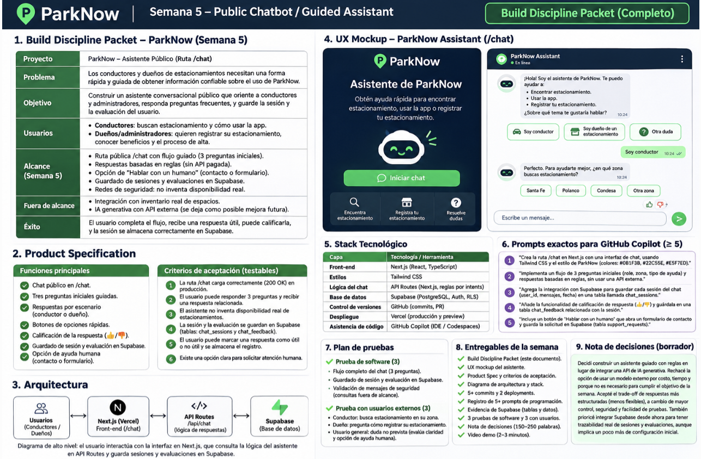

# ParkNow — Week 5 UX Mockup

## Public Chatbot — /chat

**Student:** Adriano García Llanos
**Status:** Approved UX concept before coding

## Screen 1: Welcome
- ParkNow logo and Assistant header.
- Welcome message explaining the chatbot.
- Three quick options: Driver, Parking Lot Owner, Other Question.
- Start Chat button.

## Screen 2: Guided Intake
- Question 1: What type of user are you?
- Question 2: What do you need help with?
- Question 3: What area or specific issue do you have?
- Quick-reply chips and chat bubbles.

## Screen 3: Guided Answer
- Relevant answer based on the user's selections.
- Safety message: parking availability is not guaranteed without verified live data.
- Human-help option.

## Screen 4: Feedback
- Thumbs up and thumbs down buttons.
- Session summary and feedback saved in Supabase.
- Clear confirmation only after a successful save.

## UX Principles
- Responsive mobile and desktop design.
- Accessible labels and keyboard-friendly controls.
- ParkNow navy and green visual identity.
- No invented availability or unsupported claims.

## Human Checkpoint
Approved: rule-based guided assistant, three initial questions,
feedback, Supabase persistence, and human-help option.

**Note:** This document describes the planned UX,
not a completed implementation.## Visual UX Mockup

