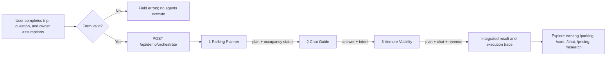

# ParkNow — Week 6 UX Mockup

**Required route:** `/demo`  
**Status:** Approved UX specification implemented on `week6-implementation`; see [submission evidence](./WEEK6_SUBMISSION.md) for verified and pending checks.
**Brand:** Preserve ParkNow's existing dark navy background, green/emerald accents, light text, rounded cards, and shared navigation.

Related planning: [Build Discipline Packet](./WEEK6_BUILD_DISCIPLINE_PACKET.md) · [Architecture](./WEEK6_ARCHITECTURE.md)

## UX purpose

Give a driver, parking-lot operator, or evaluator a short, trustworthy tour of ParkNow and let them run a real, bounded multi-agent workflow. The three deterministic agents execute on the server and exchange structured results. The interface must distinguish this new Week 6 orchestration from the existing parking, pricing, and chat features it reuses.

The workflow is not an LLM-based autonomous team: it makes no OpenAI calls, does not persist runs, and cannot reserve or change occupancy. Its occupancy is always disclosed as simulated/unverified.

## Implemented page outline

### 1. Hero — “See how ParkNow works”

- One-sentence value proposition: a prototype for exploring parking options and lot-owner workflows.
- Status badge: **Prototype — availability is simulated or unverified; not a verified live feed.**
- Two clear entry actions: **Explore as a driver** (`/parking`) and **Explore as an operator** (`/pricing`).
- A short contents/navigation list for the guided walkthrough.

### 2. Guided input — “Run the ParkNow agent team”

Show one responsive form divided into three clearly labelled groups; stack the groups on mobile. Prefill the worked example but let the user edit it:

- **Trip request:** destination, arrival time, duration minutes, maximum walking minutes, budget, accessibility requirement.
- **Parking question:** one question with the existing 300-character limit; default: “Is there parking available right now?”
- **Owner scenario (hypothetical):** Basic, Pro, and Enterprise customer counts, defaulted to the existing `Expected` scenario (20 / 10 / 3). Label the counts as assumptions, not customers.

Button: **Run three-agent demo**. Validate all fields before sending; show field-level errors and do not call the route for invalid input. Disable repeat submission while a run is in progress. Display a concise aggregate “Running the three-agent workflow…” status; do not pretend to stream individual agents if the request is synchronous.

### 3. Visual UX flow



Low-fidelity layout:

```text
+------------------------------------------------------------------+
| PARK NOW    Integrated demo                 SIMULATED / UNVERIFIED|
| Guided venture walkthrough | What is real | Impact & next steps  |
+------------------------------------------------------------------+
| TRIP REQUEST                                                     |
| Destination | Arrival | Duration | Max walk | Budget | Access    |
| PARKING QUESTION                                                 |
| [Is there parking available right now?                          ]|
| OWNER SCENARIO (HYPOTHETICAL)                                    |
| Basic customers | Pro customers | Enterprise customers           |
| [Run three-agent demo]                                           |
+------------------------------------------------------------------+
| EXECUTION TRACE (ordered)                                        |
| 1 Parking Planner  [completed] -> plan + occupancy status        |
|       └──────────── consumed by ───────────────────┐             |
| 2 Chat Guide       [completed] <- plan + question  │             |
|       └──────────── consumed by ───────────────────┼──┐          |
| 3 Venture Viability [completed] <- plan + intent + assumptions  |
+------------------------------------------------------------------+
| INTEGRATED RESULT | simulation caveat | hypothetical revenue     |
| Existing feature links | evidence status | impact / risk | V2    |
+------------------------------------------------------------------+
```

After response, render the actual ordered agent records from the API, not static success labels. Each card shows agent ID/name, status, a short input summary, output summary, and “Received from” references. Link arrows are labelled with the data exchanged. For failed or blocked steps, show the error/status and retry action; never fabricate a result.

### 4. Agent map — current functionality vs new Week 6 agents

Use the heading **“Three agents, one coordinated demo”** and a legend: **Existing feature reused** / **New Week 6 orchestration**. Explain that these are deterministic task agents, not LLM-based autonomous agents.

| Agent | Existing functionality reused | New Week 6 responsibility and data handoff | Visible output and limit |
|---|---|---|---|
| **Parking Planner Agent** | `/core` filtering/ranking rules; `/parking`'s lot-1 `parking_spaces` query shape | New wrapper receives trip form, runs existing planning logic, and reads an occupancy snapshot. Sends `plan` and separate `occupancyContext` to Chat Guide and Venture Viability. | Best/backup, estimate, walk minutes, risks, occupancy query state. Snapshot is **SIMULATED / UNVERIFIED**, marked `facilityRelation: unverified_to_plan`, and does not change planner ranking or guarantee a space. |
| **Chat Guide Agent** | `getChatReply` from `lib/chatRules.mjs` | New wrapper receives the user's question plus the Parking Planner output and answers via existing deterministic rules. Sends `intent` and guardrail answer to Venture Viability. It does not call chat persistence. | Intent, answer, human-help flag, data caveat, `consumedFrom: parking-planner`. |
| **Venture Viability Agent** | `parseCustomers` and `calculateRevenue` from `lib/pricingScenarios.mjs`; current `/pricing` assumptions | New wrapper receives customer assumptions plus planner and chat outputs; validates counts and calculates a scenario. | Monthly/annual MXN model, assumptions, `consumedFrom: parking-planner, chat-guide`. Not actual revenue, occupancy-based forecast, or willingness-to-pay evidence. |

The **orchestrator** validates the request, assigns one run ID, executes each agent exactly once in order, and returns each output with `status` and `consumedFrom` references. A parking query error is shown as `error` while the independent simulated trip plan remains labelled as such. A required agent failure marks downstream agents blocked. The UI shows the returned trace so users can distinguish execution from a diagram.

### 5. Example input and output

Label the parking result **“Illustrative output from today's `/core` rules — not a live availability result.”** Label the owner result **“Hypothetical subscription scenario — not actual revenue.”**

**Example input**

- Destination: City Hall
- Arrival: any valid selected time (the current ranking does not use it)
- Duration: 90 minutes
- Maximum walking time: 15 minutes
- Budget: $10
- Accessibility: None

**Expected output from the current deterministic rules**

- Best option: Central Garage
- Estimated cost: $6 (two billable hours × $3/hour)
- Walking time: 6 minutes
- Backup: Market Street Lot
- Risk: availability may change before arrival; travel time and final charges are not simulated
- Caveat: options, rates, walking times, and capacity are hard-coded prototype values. No space is reserved or confirmed.
- Show any Supabase count in a separate **Occupancy context — simulated/unverified** card. Do not attribute it to the recommended lot or assert that it confirms the recommendation.

**Chat Guide Agent**

- Question: “Is there parking available right now?”
- Response: current chat-rule response says ParkNow cannot confirm real-time availability and warns that occupancy is simulated/unverified.
- Handoff displayed: `intent: availability` plus the planner result and occupancy caveat consumed by Venture Viability.

**Venture Viability Agent**

- Assumptions: Basic 20, Pro 10, Enterprise 3 hypothetical customers.
- Output: $36,967 MXN/month; $443,604 MXN/year using current `/pricing` formulas.
- Explanation: `20×499 + 10×1,499 + 3×3,999`; excludes costs, taxes, discounts, cancellations, actual customer counts, and validated willingness to pay.

The sample should match the existing `buildPlan` and `calculateRevenue` logic. The existing calculations remain deterministic; the new wrappers coordinate and exchange the outputs without claiming a generative AI process.

### 5. Saved results and records

Use route links and concise status labels instead of introducing a new persistence feature:

- **Orchestration run:** result lives only in the current page response/state; it is not saved. Use `/core` or `/pricing` to explore each existing feature's own save behavior.
- **Trip recommendations:** `/core` saves results to `core_outputs` and shows up to three recent saved outputs when Supabase is configured.
- **Research records:** `/research` saves form entries to `research_records`; `/dashboard` shows a research summary.
- **Chat conversations and feedback:** `/chat` saves conversations/messages and answer feedback through server routes when configured. It does **not** currently display a browsable prior-conversation list.
- **Pricing scenarios:** `/pricing` saves scenarios in browser `localStorage`, not Supabase; they are local to that browser.
- **Marketing content:** `/marketing` saves content in browser `localStorage`, not Supabase; it is local to that browser.

If a database is unavailable or unconfigured, say so plainly and link to the relevant feature. Do not show placeholder records as real saved user results.

### 6. Testing evidence summary

Use a small status panel with labels such as **Existing**, **Historical report**, **Pending**, and **Not verified**:

| Evidence shown | Truthful status for the current implementation |
|---|---|
| Repository automated checks | `npm test` passes 49 tests, including the new planner/orchestrator coverage; `npm run build` succeeds. See the submission for run details. |
| Prior Week 5 test report | `WEEK5_SUBMISSION.md` reports a historical automated pass and production `/chat` HTTP 200 on 2026-11-06; not a Week 6 result or a current live check. |
| Saved Supabase chat evidence | Week 5 records owner-reported manual observations; no attached export/screenshots are included there. |
| Five external Week 6 sessions | Pending; collect actual participant records. `USER_TESTING.md` has partial historical entries, not five complete Week 6 sessions. |
| Two Week 6 deployments | Two successful Preview deployments are recorded; both `/demo` paths redirect to Vercel SSO. Hosted page behavior remains unverified. |
| Five actual coding prompts | One implementation authorization prompt is recorded; do not invent four more. |

Update this panel only from dated run output, deployment records, or participant evidence. Keep historical and independently reproduced evidence separate.

### 7. Practical impact, viability, and risk assessment

| Area | Potential value (hypothesis) | What is not yet demonstrated | Risk / mitigation |
|---|---|---|---|
| Driver experience | Easier orientation to parking options and a more understandable trip-planning flow | Reduced search time, successful arrivals, or user trust | Misleading availability could cause wasted trips; label simulation and do not guarantee a space |
| Operator value | A shared view and illustrative pricing tools may help explain possible workflows | Willingness to pay, retention, revenue, or operational savings | Pricing is illustrative and no payments are processed; validate with operators before monetization claims |
| Environmental impact | Better-informed parking decisions might reduce unnecessary circulation | Any measured reduction in vehicle distance, congestion, or emissions | Do not publish an impact number without baseline data, a study design, and collected results |
| Safety and access | Clearer caveats and legible status labels may support safer decisions | Verified facility layouts, accessible-space accuracy, or real-time freshness | Never encourage interaction while driving; validate accessible-space information with facility operators |
| Data and AI | Existing records and a constrained Q&A prototype can support learning | Verified occupancy source, model accuracy, privacy review, or sustainable AI cost | Explain provenance; review Supabase policies and OpenAI cost/data handling before expanded use |

### 8. Version 2 roadmap (conditional)

1. **Validate the problem:** complete five external-user sessions and separate driver/operator feedback; prioritize observed confusion.
2. **Establish data trust:** interview facility operators, document a data owner/source, update cadence, stale-data behavior, and verification evidence before any “real-time” claim.
3. **Improve accessibility and wayfinding:** validate lot layout, space numbering, and accessibility details with operators and users.
4. **Measure outcomes:** agree on a baseline and pilot metrics for task completion, search time, and user comprehension; only then evaluate environmental or commercial outcomes.
5. **Assess product readiness:** review privacy, authorization, AI cost, operational support, and payment requirements before proposing accounts, live integrations, or paid workflows.

No roadmap item is authorized by this mockup.

## Agent-level UX acceptance checks

| ID | Observable requirement | Pass condition / evidence |
|---|---|---|
| UX-A1 | Parking Planner card shows actual plan output and a separately labelled occupancy source status. | Test scenario yields the same Central Garage/$6/6-minute result as `/core`; card always displays `SIMULATED / UNVERIFIED` and `unverified_to_plan`; absent/error source is not shown as zero or live, and counts are not attributed to the static recommendation. |
| UX-A2 | Chat Guide card shows output derived from the submitted question and a planner handoff. | Availability input returns existing guardrail text; card says it consumed the planner output; unsupported input preserves the existing human-help boundary. |
| UX-A3 | Venture Viability card shows validated customer counts and calculation from existing pricing rules. | Expected scenario shows $36,967 MXN/month and $443,604/year, names both prior agents as inputs, and labels all counts/revenue hypothetical. |
| UX-A4 | Trace is grounded in API response, not static mock data. | Each displayed agent ID/status/output/`consumedFrom` exactly matches the current run response; a failed step and downstream blocked step are visibly distinct. |

## Interaction, accessibility, and responsive requirements

- Reuse shared navigation and page layout; all route links have descriptive names and visible keyboard focus.
- Use semantic headings in order, sufficient contrast, and text labels in addition to status colors.
- Keep each section scannable; provide a narrow-screen stacked layout without horizontal page scrolling.
- Keep the simulation/unverified-data notice visible near the example and occupancy explanation.
- Do not show a “completed” agent card until the orchestrator returns its successful result; use an aggregate busy state while the synchronous request is pending.
- On validation failure, identify the field and do not claim that any agent executed. On service/agent failure, show the reported status and do not silently substitute sample data.
- State that the orchestration run is not saved and has no parking, chat, or pricing side effect.
- Avoid auto-playing media, blinking alerts, or controls that imply a live simulation.
- Ensure the page works with keyboard navigation and a screen reader's heading/link lists.

## UX acceptance checks

| ID | Check | Evidence |
|---|---|---|
| UX-01 | At 360px mobile and desktop widths, all sections and links are visible/reachable without horizontal page overflow. | Screenshots and manual viewport check |
| UX-02 | Keyboard-only user can reach every link in logical order and see focus. | Keyboard checklist |
| UX-03 | Five participants run the workflow; at least four can identify all three agents and explain one data handoff. | Five dated, anonymized session records |
| UX-04 | At least four of five participants correctly state occupancy is simulated/unverified and revenue is hypothetical. | Individual response records |
| UX-05 | Every displayed example value, output, and agent status comes from actual implementation behavior. | API response capture and source/test check |
| UX-06 | Evidence panel does not present historical or owner-reported results as current independent verification. | Content review against packet |

## Human checkpoint

The project owner approved the orchestration scope, deterministic-vs-LLM distinction, inputs, outputs, handoffs, error states, copy, example, saved-record claims, evidence wording, participant plan, and roadmap on 2026-11-18 and authorized implementation on `week6-implementation`. Preview deployments are allowed; merging and Production deployment are not. If the official rubric requires LLM-based autonomous agents, pause for a cost/privacy/safety decision.
